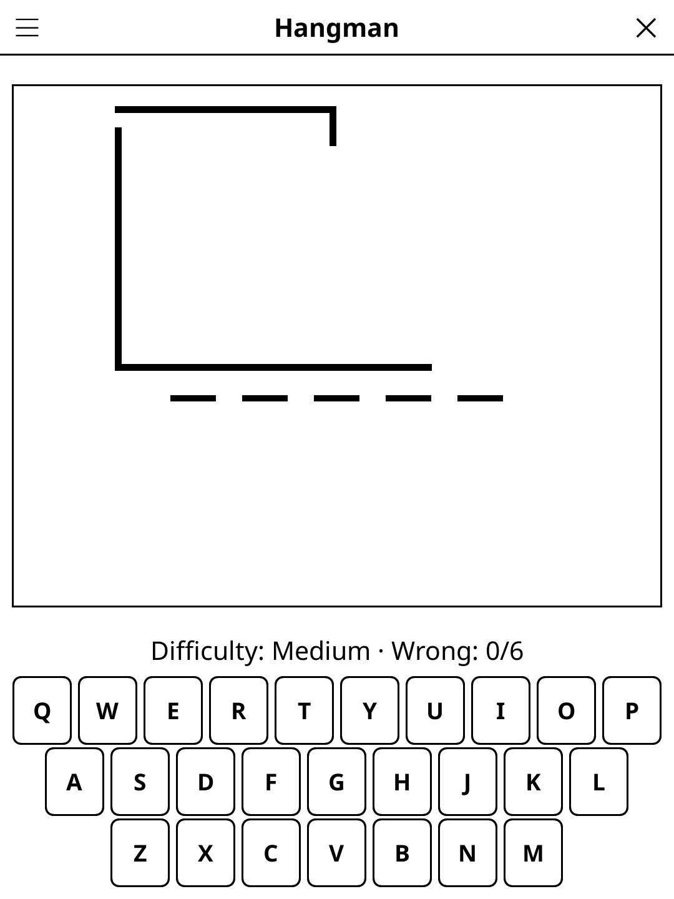

# hangman.koplugin

A Hangman plugin for [KOReader](https://github.com/koreader/koreader).

## Screenshot

## Rules

Guess the hidden word letter by letter. Each wrong guess adds a body part to the hangman figure. Reveal the complete word before the figure is drawn — you have a limited number of wrong guesses.

## Concept

Guess the hidden word one letter at a time. Each wrong guess adds a part to
the hangman drawing. Reveal the full word before the drawing is complete to win.

## Features

- **Multiple languages** — word lists for EN, FR, DE, ES
- **Configurable word length** — short (3–5), medium (6–8), long (9+)
- **Difficulty levels** — Easy (8 wrong guesses allowed), Medium (6), Hard (4)
- **Category mode** — words from specific categories (animals, countries, food…)
- **ASCII art drawing** — progressive hangman illustration rendered in monospace
- **Statistics** — win/loss ratio and average guesses
- **Auto-save** — in-progress game restored on next launch

## Multiplayer

Pick **Hangman · multiplayer** (Tools → Games → Party & quiz), or *Mode:
Multiplayer* in the game menu, and lay the reader in the middle of the table.
2 to 4 teams take turns on one word; the team to play is shown in big type.

- **Word**: from the word list (default), or *typed by a player*: each round
  one team in turn picks the word on a hand-over screen — one of its players
  types it (hidden as typed) while the others look away — and that team sits
  the round out. "Word from the list" skips typing for that round.
- A right letter keeps the turn; a wrong letter adds a miss and **passes the
  turn**.
- **Guess the word**: on its turn a team may try the whole word. Wrong costs
  the team 1 point, adds a miss and passes the turn.
- The team that completes the word scores **misses left + 1** (Medium: 7 with
  no miss, 2 with five). If the drawing is finished, the word is revealed and
  nobody scores.
- A match is 3, 5, 7 or 10 words (*Rounds*). Team names are remembered; the
  match is saved when you leave and does not touch your solo game.

## Controls

| Action | How |
|--------|-----|
| Guess a letter | Tap it on the on-screen alphabet |
| New game | Tap **New game** |
| Change language | Tap **Language** |
| Change difficulty | Tap **Difficulty** |
| Show rules | Tap **Rules** |

## Why e-ink friendly?

Each guess is a single tap that triggers at most one screen update.
The ASCII art hangman drawing is a natural fit for monospace e-ink rendering.

## License

GPL-3.0
